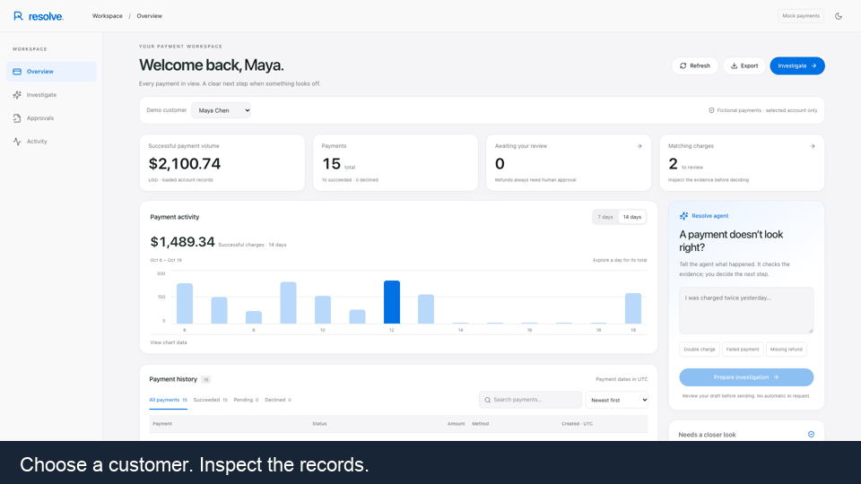
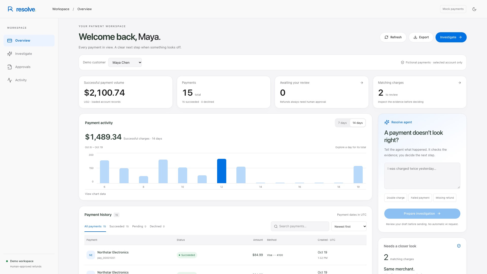
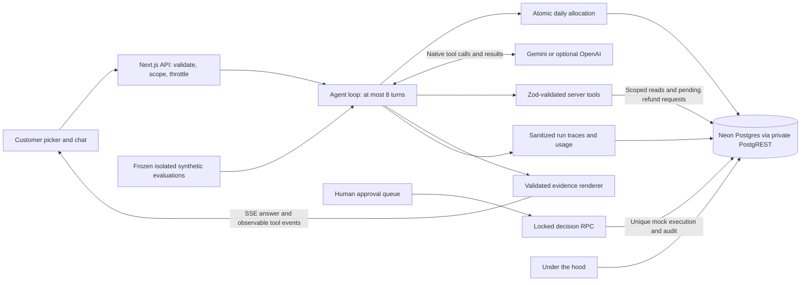

# AI Payment Dispute Agent

> Public runtime: `88c693c`. Latest identified answer issue is fixed and verified. Updated media below captures the deployed workflow. [Qualification evidence](docs/evidence-qualification-results.md).

Investigate fictional payment disputes with Gemini tools, inspect the evidence, and keep refund approval human.



**[Live demo](https://resolve-payments.onrender.com/payments)** · **[Narrated walkthrough](docs/resolve-demo-current.mp4)** · [20-second launch video](docs/resolve-launch-current.mp4) · [Source](https://github.com/NishithVadlamudi/AI-Payment-Dispute-Agent) · [CI](https://github.com/NishithVadlamudi/AI-Payment-Dispute-Agent/actions/workflows/ci.yml)

Built with Next.js, TypeScript, Gemini native tool use, Neon Postgres and private PostgREST. Code renders final explanations from validated records while Gemini selects tools. No real bank or processor is connected. The GIF shows five actual captured UI steps over 15 seconds, ending in an unsent draft. The updated 54.17-second walkthrough uses the accurate sections of the supplied voice, with current test counts shown on screen. Original narration and earlier drafts remain preserved. [Media and career handoff](docs/media/current-handoff.md).


## Results and limits

| Measurement | Before / baseline | Observed result |
| --- | --- | --- |
| Compatible untouched holdout baseline | Not measured | No before/after accuracy claim is possible |
| Frozen synthetic holdout | Not measured | 16/16 automated checks; manual review found two status errors and two money-presentation issues |
| Post-holdout targeted campaign | Separate protocol | Five passes, one genuine unusable-answer failure; preserved |
| Fresh post-fix smoke set | Separate protocol, not a new holdout | Three automated/manual passes; no infrastructure errors or retries |
| Key-free regression checks | 131 checks at the earlier milestone | 194 checks pass; test counts are not coverage percentages |
| Isolated Neon integration checks | 29 checks at the earlier milestone | 35 checks pass |
| Frozen evidence qualification | Separate synthetic protocol | 21/22 model answers pass full review; 22/22 coarse automatic checks and 2/2 guards. Subsequent balance-limit correction verified separately. |
| Deterministic post-fix replay | Recorded traces, not fresh model accuracy | 22/22 recorded tool traces pass the deployed renderer; original model score remains unchanged. |
| Public deployed Gemini investigation | Earlier provider failures preserved | Revision `88c693c`: correct balance limit and no-request outcome; 7,808 ms, unchanged refunds. |

[Full development evidence](docs/development-evaluation-complete.md), [holdout limitations](docs/holdout-results.md), [targeted failures](docs/post-holdout-validation-results.md), [fresh smoke checks](docs/output-handling-validation-results.md), and [public verification](docs/rollout-932d8c3.md), and [answer recovery](docs/answer-recovery-verification.md). Infrastructure recovery is not model-accuracy improvement. These small synthetic datasets do not establish real financial-domain reliability. The public reviewer is fictional, not authenticated staff access.



## Architecture



## Engineering decisions

| Decision | Why it matters |
| --- | --- |
| Human approval | The model can propose a refund but has no approval or execution tool. |
| Database idempotency | Charge locks and unique execution keys prevent duplicate mock refunds during retries, double clicks and concurrent approvals. |
| Integer cents and SQL rules | Refunds require a succeeded charge and cannot exceed the balance after prior refunds and pending reservations. Approval rechecks eligibility. |
| Server-enforced customer scope | The selected customer's identity is bound by the server, not chosen by model arguments. |
| Layered injection controls | A limited explicit-override guard, typed tools, SQL rules and approvals enforce boundaries. Pattern matching alone is not a complete defense. |
| Shared rate and budget controls | Postgres counters coordinate instances. Each model turn reserves a conservative daily allowance before access; no automatic paid fallback. |
| Evidence-based answers | Model prose stays server-side; summaries use validated amounts, identities, refund states and applicable reference records. |
| Audits and safe traces | Tool attempts/results and human decisions are recorded. Traces omit private thoughts, raw conversation context, credentials and upstream error bodies. |

The atomic execution guarantee covers the mock Postgres ledger. Real payment integration would also require provider idempotency and an outbox/reconciliation workflow. Accounting allowances are conservative estimates, not verified current pricing or a provider-enforced billing ceiling.

## Free hosting

The deployment target is **Render Free + Neon Free**, with no Vercel or Supabase hosting required. [Deployment setup](docs/free-deployment.md) includes the one-service Blueprint, private environment settings, automated migrations, free-plan limits and verification status. The public demo is live at [resolve-payments.onrender.com](https://resolve-payments.onrender.com/payments). Its first request after inactivity may take 50 seconds or longer; data persists in Neon. HTTPS health, customer/payment access and the matching-payment detail flow were verified. A [public Gemini investigation](docs/provider-debugging.md) completed successfully on October 29, 2026; earlier provider failures remain documented.

## Try the workflow

| Page | Purpose |
| --- | --- |
| `/` | Project introduction and Try it button |
| `/payments` | Customer-scoped dashboard, payment activity, history, details and investigation drafts |
| `/demo` | Select a customer, describe a problem, inspect streamed text and collapsible tool activity |
| `/approvals` | Review evidence and approve or reject a mock refund |
| `/under-the-hood` | Inspect sanitized traces, tokens, latency, estimated cost and evaluation reports |

Scenario buttons cover a double charge, failed payment, missing refund and explicit injection attempt. Demo data includes **20 customers and 300 transactions**. The UI supports mobile screens and light/dark themes. Tool activity is observable evidence, not private model reasoning.

## Run locally

For the verified Neon setup: preserve `.env.local`, use Node.js 24 and PostgREST v13, run `npm ci` and `npm run build`, then `npm run start:neon`. The private HTTP adapter uses the Neon database connection; its HTTP client must never receive a Postgres URL. Follow [the local guide](docs/local-development.md) for certificates, migrations and private configuration.

The commands below are an alternative disposable local test harness; their results do not verify Neon connectivity.

For the complete app and Codex skills handoff, use [Continue locally with Codex](docs/local-development.md).

Use **Node.js 24**, npm and Docker. Get a Gemini key from [Google AI Studio](https://aistudio.google.com/apikey) and verify your project's model access, pricing and quotas; free usage is not guaranteed.

```bash
git clone https://github.com/NishithVadlamudi/AI-Payment-Dispute-Agent.git
cd AI-Payment-Dispute-Agent
npm ci
npm run db:test:start
# Only for a fresh checkout: preserve an existing .env.local.
cp -n .env.test-db .env.local
```

The smaller local harness runs Postgres 17, PostgREST and a gateway; it is not the full Supabase platform. It generates ignored local database credentials and applies the versioned migrations. Add these server-only values to `.env.local` alongside the generated database bindings:

```dotenv
AI_PROVIDER=gemini
GEMINI_API_KEY=<your key>
GEMINI_MODEL=gemini-3.5-flash-lite
```

Then, for an unseeded demo database:

```bash
npm run db:seed
npm run dev
```

Open port 3000 in your local browser. The database volume persists; `npm run db:test:stop` stops it without deleting data. Re-seeding intentionally refreshes the known sample timestamps/statuses. Preserve requests made during demo use. See [.env.example](.env.example) for budget/rate options and [the engineering guide](docs/engineering.md) for full local Supabase, hosted Supabase, provider configuration and troubleshooting.

For OpenAI, explicitly select `AI_PROVIDER=openai`, provide `OPENAI_API_KEY`, and choose `OPENAI_MODEL` (default `gpt-5-mini`). Configure matching `AI_BUDGET_PROVIDER` and `AI_BUDGET_MODEL` values. Provider switching never happens automatically. Keep all secrets on the server and out of Git.

## Validation and evaluations

```bash
npm test              # Mocked providers; no model calls
npm run typecheck
npm run build
npm run test:db       # Disposable migrated/seeded local database
npm run eval:validate # Validate the 40-case dataset without model calls
npm run eval          # Live evaluation; consumes quota and daily allowance
```

Current local checks include **160 unit/API/UI tests** and **34 isolated Neon database integration tests**, including concurrent approvals, uniqueness constraints, refund limits, customer scope, injection controls, the agent loop and persistent tracing. CI and the live Render deployment are verified at `932d8c3`; [rollout evidence](docs/rollout-932d8c3.md) separates public checks from isolated recovery validation. Responsive browser checks cover five pages at seven viewport sizes (320–1920px, including landscape) in light and dark modes. Safari/WebKit device verification remains outstanding; see [the verification notes](docs/responsive-workspace.md).

The [development evaluation](docs/development-evaluation-complete.md) completed all **40 automated cases** across preserved batches: 32 model-backed cases and eight deterministic guards. The [frozen holdout](docs/holdout-results.md) completed **16/16 automated cases** (14 model-backed, two guards), without infrastructure errors. Manual answer review nevertheless found two misleading refund-status explanations and two money-presentation issues missed by the scorer. These are small synthetic datasets, not established real-world accuracy. The subsequent targeted campaign completed five passes and one genuine unusable-answer failure. After a local handling fix, a [fresh three-case smoke set](docs/output-handling-validation-results.md) passed automated/manual review; these small targeted results do not establish general accuracy. The old holdout is retired for improvement claims. There is no compatible pre-change holdout baseline. The original [partial report](docs/evaluation-results.md), including quota/budget failures, remains unchanged; do not interpret infrastructure recovery as an accuracy gain. Missing cost is unknown, not zero.

The runner now skips further model-backed cases after a shared provider/budget failure. Do not raise or clear the allocation ledger to force a result. Provider quotas and the UTC-day application allowance are separate controls.

## Deploy

Use the existing Render Free Docker service and Neon Postgres project; see [free deployment](docs/free-deployment.md). Versioned migrations apply without resetting data. Keep Gemini keys and database bindings in Render’s private environment settings. Do not seed an existing database or expose PostgREST publicly.

## Project layout and recording

```text
src/app/              Pages and server API routes
src/components/       Landing, investigation, approvals, observability and shared UI
src/lib/              Agent/providers, tools, database, security, tracing and evals
supabase/migrations/  Versioned Postgres migrations
evals/cases.json      40 live evaluation cases
scripts/              Seed, local database harness, eval CLI and optional demo capture
tests/                Unit, API, UI and database integration suites
```

The optional `scripts/capture-demo.py` uses Python Playwright and system Chromium to capture seven labeled replay frames against a running local app. `docs/demo-replay.json` contains only fictional recorded evidence and the partial evaluation report; it is never an application fallback. See [recording instructions](docs/demo-recording.md).
